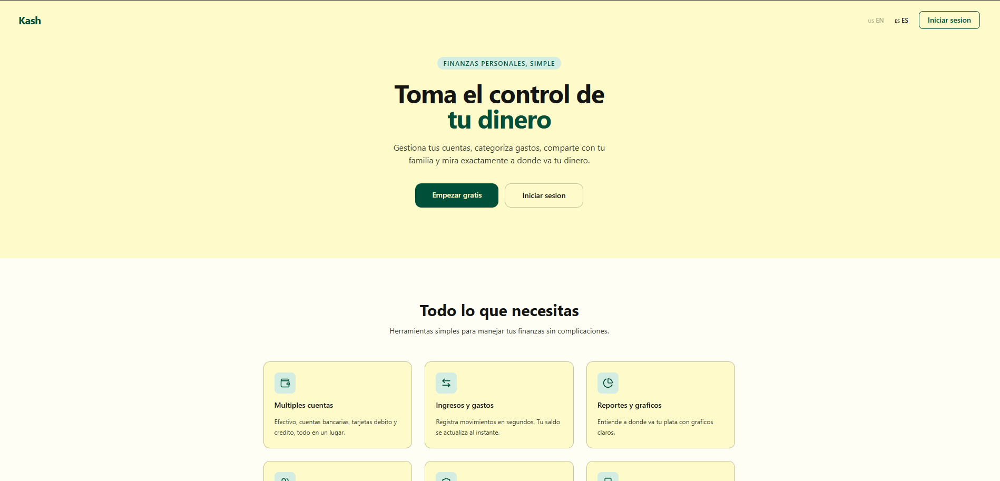
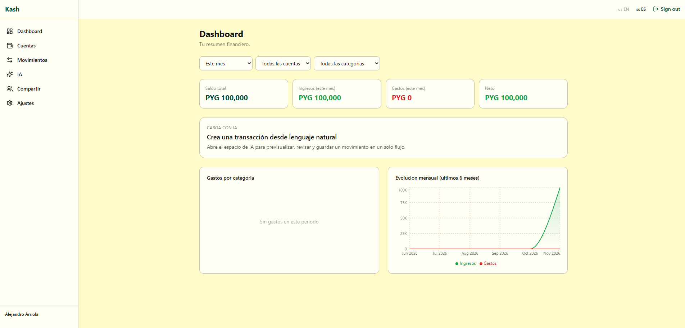
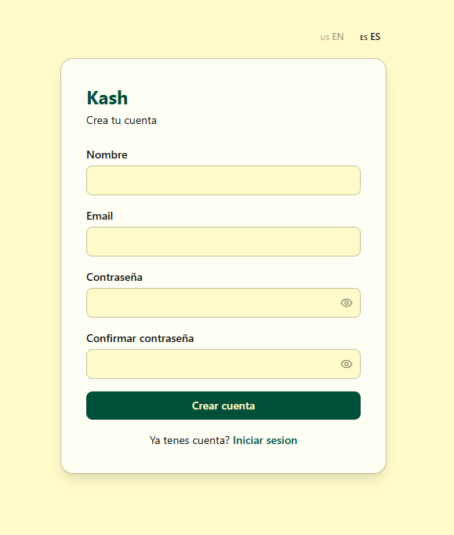
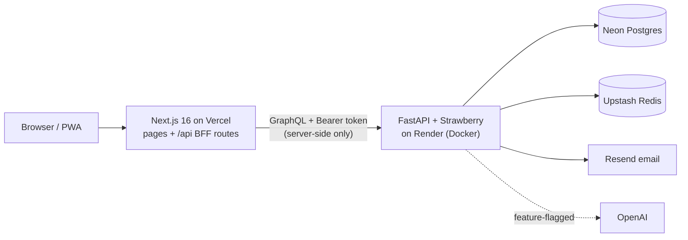

# Kash

Personal finance app for tracking wallets, income and expenses, sharing accounts with family, and reading your spending through charts. Bilingual (English/Spanish), installable as a PWA, with an AI assistant that turns a sentence like *"lunch 45.000 with the debit card"* into a transaction you confirm before saving.

**Live:** [kash-py.com](https://www.kash-py.com)

> The backend runs on a free instance that sleeps when idle, so the first request after a while can take 30–60 seconds while it wakes up.

| Landing | Dashboard | Sign up |
|---|---|---|
|  |  |  |

---

## Features

- **Wallets**: cash, bank, debit and credit, each with its own currency and live balance
- **Transactions**: income and expenses with categories (global defaults plus your own)
- **Dashboard**: expenses by category and monthly evolution, filtered by period, wallet or category, one view per currency
- **Shared wallets**: invite people by email as viewer or editor; accept, reject, cancel or leave
- **AI transaction capture**: write what happened in plain language, review an editable preview, then save (private beta, disabled in the public deploy)
- **Accounts**: email verification, profile and password management
- **UX**: light/dark theme, English/Spanish, responsive layout (sidebar on desktop, bottom nav on mobile), installable PWA

---

## Architecture



- **Backend-for-frontend**: the browser never talks to the API directly. Next.js API routes keep the JWT in an HttpOnly cookie and forward GraphQL requests with the token attached, so client-side JavaScript never sees a token.
- **Layered GraphQL modules**: each domain (`users`, `wallets`, `categories`, `transactions`, `invitations`, `reports`, `ai_chat`) has its own models, repositories (data access only), services (business rules and permissions), types, queries and mutations.
- **Dependency injection** with `aioinject`: repositories and services are scoped per request, with no global state.
- **Unit of work per request**: a GraphQL middleware opens the DB transaction, repositories only `flush()`, and the middleware commits or rolls back.
- **Idempotent creates**: every create mutation accepts an idempotency key stored in Redis, so double submits on flaky mobile connections don't duplicate data.
- **Guarded AI flow**: the AI only produces a preview; saving always goes through the regular transaction service. Access is limited by a feature flag, an email allowlist/blocklist, a daily per-user rate limit, an input length limit and suspicious-prompt detection. Each preview is logged as accepted, edited or cancelled to measure how useful it is.

---

## Stack

| Layer | Tech |
|---|---|
| Backend | Python 3.13, FastAPI, Strawberry GraphQL, SQLAlchemy 2.0 (async), aioinject, Alembic, pydantic-ai |
| Frontend | Next.js 16 (App Router), React 19, React Query 5, react-hook-form + Zod, Tailwind CSS, Radix UI, Recharts |
| Data | PostgreSQL 16, Redis (idempotency, rate limits, email verification tokens) |
| Auth | JWT (HS256) in HttpOnly cookies, bcrypt password hashing |
| Infra | Render (API, Docker), Vercel (web), Neon (Postgres), Upstash (Redis), Resend (email), Cloudflare (DNS) |
| Tooling | uv, pnpm, Ruff, basedpyright, ESLint, pytest |

The whole production stack runs on free tiers that stop instead of charging when a limit is reached.

---

## Database Branching (Neon)

Postgres runs on [Neon](https://neon.tech) with two branches:

| Branch | Used by |
|---|---|
| `production` | Deployed backend on Render |
| `dev` | Local development (child of `production`) |

Migrations are applied to `dev` first by running `uv run alembic upgrade head` locally. `production` is only migrated by the deployed backend: its Docker image runs `alembic upgrade head` on startup after a merge to `main`.

Neon connection strings must be adapted for asyncpg: use the `postgresql+asyncpg://` scheme, replace `sslmode`/`channel_binding` with `?ssl=require`, and use the direct (non-pooled) host.

---

## Quick Start (local dev)

Requirements: Python 3.13 with [uv](https://docs.astral.sh/uv/), Node.js with corepack, and either Docker or your own Postgres + Redis (for example Neon and Upstash).

### 1. Infrastructure

```bash
docker compose up -d    # Postgres 16 + Redis 7
```

### 2. Backend

```bash
cd backend
cp .env.example .env    # set at least JWT_SECRET and RESEND_API_KEY
uv sync
uv run alembic upgrade head
uv run uvicorn app.api.app:create_app --factory --reload --port 8000
```

GraphiQL: http://localhost:8000/graphql (disabled when `ENVIRONMENT=production`)

### 3. Frontend

```bash
corepack enable pnpm
cd frontend
cp .env.local.example .env.local
pnpm install
pnpm dev
```

App: http://localhost:3000

---

## Environment Variables

### Backend (`backend/.env`)

Every setting is required and the app fails at startup if one is missing. See [`backend/.env.example`](backend/.env.example) for the full list.

| Variable | Description |
|---|---|
| `DATABASE_URL` | PostgreSQL connection string (`postgresql+asyncpg://...`) |
| `REDIS_URL` | Redis connection string (`rediss://` for TLS) |
| `JWT_SECRET` | Secret for signing tokens |
| `RESEND_API_KEY`, `RESEND_FROM_EMAIL` | Email delivery |
| `FRONTEND_URL` | Base URL used in email links |
| `ENVIRONMENT` | `dev` / `staging` / `production` |
| `CORS_ORIGINS` | JSON array of allowed origins |
| `OPENAI_API_KEY`, `AI_*` | AI capture settings (`AI_CHAT_ENABLED=false` turns it off) |

### Frontend (`frontend/.env.local`)

| Variable | Description |
|---|---|
| `BACKEND_GRAPHQL_URL` | Backend GraphQL URL (server-side only) |

---

## Project Structure

```
finanApp/
├── backend/
│   ├── app/
│   │   ├── api/              # FastAPI app factory, health check
│   │   ├── auth/             # JWT service, AuthInfo
│   │   ├── core/             # Settings, DI container, middleware, idempotency, rate limit, email
│   │   ├── db/               # SQLAlchemy base models, engine, custom types
│   │   └── graphql/          # Domain modules
│   │       ├── users/        # Register, login, profile, email verification
│   │       ├── wallets/      # CRUD, roles, members, leave
│   │       ├── categories/   # Global defaults + per-user custom
│   │       ├── transactions/ # Income/expense with balance calculation
│   │       ├── invitations/  # Invite, accept, reject, cancel
│   │       ├── reports/      # Dashboard aggregations, multi-currency
│   │       └── ai_chat/      # Natural-language parsing, validation, event tracking
│   ├── alembic/              # Database migrations
│   ├── config/               # AI beta allowlist/blocklist examples
│   └── tests/                # pytest suite
├── frontend/
│   ├── app/                  # Routes: landing, auth, dashboard, API (BFF) routes
│   ├── components/           # UI by domain, hooks, i18n, GraphQL client
│   ├── public/               # PWA manifest, icons, service worker
│   └── proxy.ts              # Redirects unauthenticated users away from protected routes
└── docker-compose.yml        # Local Postgres + Redis
```

---

## Tests

The backend has 132 pytest tests across users, auth, email verification, idempotency, wallets, categories, transactions, invitations, reports and the AI flow. They create a separate `finanapp_test` database, so run them against the local Docker Postgres:

```bash
cd backend
uv run pytest
```

Frontend checks:

```bash
cd frontend
pnpm lint
pnpm build
```

---

## Development Workflow

- `feature/`, `chore/` and `hotfix/` branches start from `staging`, get merged back into `staging`, and `staging` is merged into `main`: `main` auto-deploys to Render and Vercel.
